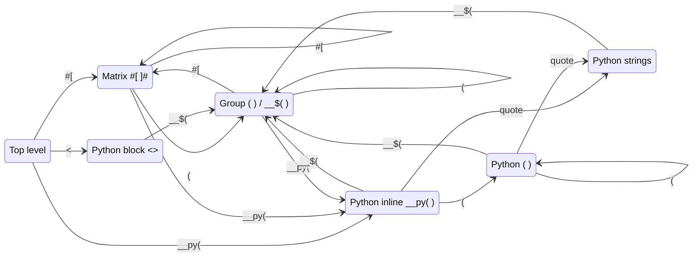

# FDS Language — Grammar Guide

> **Who this is for**
> - **New to the language?** Read top to bottom. Every idea is introduced once, with examples.
> - **Revising the grammar files?** Jump to [§10 Map to the grammar files](#10-map-to-the-grammar-files). Every token and rule name from `fds_lexer.g4` and `fds_parser.g4` is listed there with the section that explains it.

---

## Contents

1. [The language at a glance](#1-the-language-at-a-glance)
2. [How a program is read](#2-how-a-program-is-read)
3. [Words: the vocabulary](#3-words-the-vocabulary)
4. [Reading zones: where a newline means something](#4-reading-zones-where-a-newline-means-something)
5. [Sentences: the structure of a program](#5-sentences-the-structure-of-a-program)
6. [Expressions and their order](#6-expressions-and-their-order)
7. [Matrices](#7-matrices)
8. [Python interop](#8-python-interop)
9. [Rules of thumb and common surprises](#9-rules-of-thumb-and-common-surprises)
10. [Map to the grammar files](#10-map-to-the-grammar-files)
11. [Cheat sheet](#11-cheat-sheet)

---

## 1. The language at a glance

```text
<<PY
import random
LIMIT = 100
>>

@0 = __py(random.randint(1, LIMIT));
@1 = #[
  1 2 | 5 6
  3 4 | 7 8
]#;
@2 = @0 ? @1 : -@1;
@0++;

__py(
  print("result:", __$(@2))
);
```

Line by line: run some Python, take a value from Python, build two 2 × 2 blocks side by side, choose a value, add one to `@0`, and print through Python.

| Idea | What it looks like |
|---|---|
| Variables | `@0`, `@1`, `@42` — an `@` followed by digits |
| Numbers | `7`, `3.14`, `.5`, `2e10`, `1.5E-3` |
| Arithmetic | `+ - * /`, signs `+x -x`, counters `++ --` |
| Choice | `condition ? when_true : when_false` |
| Matrices | `#[ 1 2; 3 4 ]#`, with `|` and `---` for blocks |
| Python | `__py( expression )` and `<<PY … >>` blocks, with `__$( … )` to reach back into FDS |
| Statements | end with `;` (a Python block is the one exception) |

> **Reading the examples:** the language has no comments yet. In examples, text after a `◀` is an explanation for you, not part of the code.

---

## 2. How a program is read

A program is read in **two stages**, exactly like reading a sentence in a human language:

```text
   source text                     words                          meaning
 ┌──────────────┐   stage 1   ┌──────────────────┐   stage 2   ┌──────────────────────┐
 │ @2 = @0 * 3; │ ──────────▶ │ @2  =  @0  *  3  ; │ ──────────▶ │ assign               │
 └──────────────┘  (lexer)    └──────────────────┘  (parser)   │ ├─ target: @2        │
                                                               │ └─ value: @0 × 3     │
                                                               └──────────────────────┘
```

| Stage | File | Job | Knows about |
|---|---|---|---|
| **1. Words** | `fds_lexer.g4` | Cuts the text into words (*tokens*) and throws away plain spaces | Characters only. It never sees the meaning |
| **2. Sentences** | `fds_parser.g4` | Checks that words are in a valid order and groups them | Words only. It never sees spaces or characters |

Two consequences you should remember:

- **Stage 1 always picks the longest word it can.** `++` is read as one word (*increment*), not two `+`. `---` inside a matrix is one word (*block separator*), not `--` and `-`.
- **Stage 1 decides what a newline is.** Stage 2 never sees spaces; it only sees a *newline word* (`NL`) in the one place where a newline has meaning (inside matrices). That is the whole purpose of [reading zones](#4-reading-zones-where-a-newline-means-something).

---

## 3. Words: the vocabulary

Every word the reader can produce, grouped by purpose. *Name* is the exact name used in the grammar files.

### 3.1 Values

| Looks like | Name | Full form | Meaning |
|---|---|---|---|
| `12` `1.5` `1.` `.5` `2e10` `1.5E-3` | `NUMBER` | NUMBER literal | A number. Digits, an optional decimal part, an optional exponent |
| `@0` `@17` | `VAR` | VARiable reference | A variable. `@` followed by one or more digits |

```text
NUMBER  =  digits [ "." digits? ] [ exponent ]
        |  "." digits [ exponent ]
exponent = ( "e" | "E" ) [ "+" | "-" ] digits
```

A number has **no sign**. `-5` is the *minus* word followed by `5`; the sign is applied as an operation (see [§6](#6-expressions-and-their-order)).

### 3.2 Operators

| Symbol | Name | Full form | Used for |
|---|---|---|---|
| `+` | `PLUS` | PLUS | addition, or a `+` sign |
| `-` | `MINUS` | MINUS | subtraction, or a `-` sign |
| `*` | `STAR` | STAR | multiplication |
| `/` | `SLASH` | SLASH | division |
| `++` | `INC` | INCrement | add one to a variable |
| `--` | `DEC` | DECrement | subtract one from a variable |
| `=` | `EQUALS` | EQUALS | assignment |
| `?` | `QMARK` | Question MARK | start of a choice |
| `:` | `COLON` | COLON | the "otherwise" part of a choice |

### 3.3 Punctuation

| Symbol | Name | Full form | Used for |
|---|---|---|---|
| `;` | `SEMI_COLON` | SEMI COLON | ends a statement (inside a matrix, it ends a row instead) |
| `(` | `LPAREN` | Left PARENthesis | grouping |
| `)` | `RPAREN` | Right PARENthesis | grouping, and closing `__$(` |
| `,` | `COMMA` | COMMA | reserved; not used by any sentence yet |

### 3.4 Matrix words

| Symbol | Name | Full form | Used for |
|---|---|---|---|
| `#[` | `MLBRACE` | Matrix Left BRACE | opens a matrix |
| `]#` | `MRBRACE` | Matrix Right BRACE | closes a matrix |
| newline or `;` | `NL` | New Line | next row (only inside a matrix) |
| `\|` | `VBAR` | Vertical BAR | next block, side by side (only inside a matrix) |
| a line of `---` | `HSEP` | Horizontal SEParator | next block row, top to bottom (only inside a matrix) |

### 3.5 Python words

| Symbol | Name | Full form | Used for |
|---|---|---|---|
| `__py(` | `PY_OPEN` | PYthon inline OPEN | starts a Python expression |
| `)` *(the matching one)* | `PY_CLOSE` | PYthon inline CLOSE | ends a Python expression |
| `<<PY` | `PY_BLOCK_OPEN` | PYthon BLOCK OPEN | starts a Python block |
| `>>` *(at the start of a line)* | `PY_BLOCK_END` | PYthon BLOCK END | ends a Python block |
| any Python source | `PY_TEXT` | PYthon TEXT | passed through to Python untouched |
| `__$(` | `PY_EMBED` | PYthon EMBED opener | starts an FDS expression inside Python |
| `__$$` | `PY_ESCAPE` | PYthon ESCAPE | stands for the literal text `__$` |

### 3.6 Invisible and fallback words

| Looks like | Name | Full form | What happens |
|---|---|---|---|
| spaces, tabs, form feeds | `WS` | WhiteSpace | thrown away |
| newlines (outside a matrix) | `WS` | WhiteSpace | thrown away |
| any other character, e.g. `$` | `ERROR_CHAR` | ERROR CHARacter | kept and reported as an error, so a typo is never silently lost |

---

## 4. Reading zones: where a newline means something

The same character can mean different things depending on **where** it appears:

| Character | At the top level | Inside a matrix `#[ ]#` | Inside Python |
|---|---|---|---|
| newline | just space | **next row** | Python text |
| `;` | end of statement | **next row** | Python text |
| `\|` | error | **next block** | Python text |
| `)` | grouping | grouping | Python's own, or the end of `__py(` |

The reader therefore keeps track of a **zone** (in the grammar files: a *mode*). Each zone has its own vocabulary. Opening something enters a zone; the matching closer leaves it and returns to **the zone you were in before**. Zones nest like boxes inside boxes.

### 4.1 The ten zones

| Zone (mode name) | You are inside… | Newline means | Left by |
|---|---|---|---|
| **Top level** (`DEFAULT_MODE`) | the program itself | space | — |
| **Matrix** (`MBrace`) | `#[ … ]#` | next row | `]#` |
| **Group** (`Paren`) | `( … )` inside a matrix, and every `__$( … )` | space | `)` |
| **Python inline** (`PyInline`) | `__py( … )` | Python text | the matching `)` |
| **Python nested** (`PyNest`) | Python's own `( … )` inside `__py(` | Python text | `)` |
| **Python string** (`PyStrD`, `PyStrS`) | `"…"` or `'…'` inside `__py(` | not allowed | the closing quote |
| **Python long string** (`PyStrD3`, `PyStrS3`) | `"""…"""` or `'''…'''` inside `__py(` | Python text | the closing triple quote |
| **Python block** (`PyBlock`) | `<<PY … >>` | Python text | `>>` at the start of a line |

### 4.2 How zones connect



*Every arrow is reversed by the matching closer: `]#`, `)`, a closing quote, or a line-start `>>`.*

> **Why there is no "Group" zone at the top level:** at the top level newlines are already plain space, so `(` does not need to change anything. Parentheses only need their own zone when they appear inside a matrix, where they must turn newlines back into plain space.

### 4.3 A zone walk-through

```text
@1 = #[ (1 +
         2) 3
        4 5 ]#;
```

| Text | Zone before | Word | Zone after |
|---|---|---|---|
| `@1 =` | Top | `VAR` `EQUALS` | Top |
| `#[ ` | Top | `MLBRACE` | **Matrix** |
| `(` | Matrix | `LPAREN` | **Group** |
| `1 +`↵`2` | Group | `NUMBER` `PLUS` `NUMBER` — the newline is space | Group |
| `)` | Group | `RPAREN` | **Matrix** |
| ` 3` | Matrix | `NUMBER` | Matrix |
| ↵ | Matrix | **`NL`** — next row | Matrix |
| `4 5` | Matrix | `NUMBER` `NUMBER` | Matrix |
| ` ]#` | Matrix | `MRBRACE` | **Top** |
| `;` | Top | `SEMI_COLON` | Top |

Result: a matrix with rows `[(1+2), 3]` and `[4, 5]`.

### 4.4 Safety rules built into the zones

- **A closer only leaves the zone it belongs to.** A stray `]#` at the top level, or a stray `)` directly inside a matrix, is read as an ordinary word and reported as an error. The reader never tries to leave a zone it is not in.
- **Blank lines inside a matrix are harmless.** A run of newlines, blank lines, indentation and `;` together counts as **one** row break. Newlines straight after `#[` or straight before `]#` are swallowed by those symbols.
- **Every zone has a fallback.** An unexpected character becomes an `ERROR_CHAR` word and produces a clear error instead of disappearing.

---

## 5. Sentences: the structure of a program

### 5.1 How to read the rule boxes

Rules below use a small notation:

| Mark | Meaning | Example |
|---|---|---|
| `A B` | A, then B | `VAR EQUALS expr` |
| `A \| B` | A or B | `PLUS \| MINUS` |
| `A?` | A, optional | `SEMI_COLON?` |
| `A*` | A, zero or more times | `statement*` |
| `A+` | A, one or more times | `expr+` |
| `( … )` | treat as one unit | `(COMMA expr)*` |

Names in `UPPER_CASE` are **words** (§3). Names in `lower_case` are **sentences** defined in this section.

### 5.2 Program

```text
program     =  statement*  END-OF-FILE
statement   =  simple_stmt
            |  py_block
simple_stmt =  ( expr | assignment )  ";"
assignment  =  VAR "=" expr
```

- A program is a list of statements.
- An ordinary statement is either an **expression** (evaluated for its effect, e.g. `@0++;` or `__py(print(1));`) or an **assignment**, and it always ends with `;`.
- A **Python block** is also a statement and needs no `;` (one is allowed).
- Newlines at the top level are space, so one statement may span many lines and several may share a line.

```text
@1 = 2 *
     (3 + 4);        ◀ one statement over two lines
@2 = 1; @3 = 2;      ◀ two statements on one line
```

> Assignment is a statement, not an expression: `@1 = @2 = 3;` is **not** valid.

---

## 6. Expressions and their order

### 6.1 The precedence ladder

Operators lower on the ladder hold their operands **tighter**.

```text
  loosest ┌────────────────────────────────────────────┐
     1    │  choice        a ? b : c                   │  ternary_expr
     2    │  add/subtract  a + b   a - b               │  addition
     3    │  mult/divide   a * b   a / b               │  multiplication
     4    │  signs         +a  -a                      │  unary_sign
          │  counters      ++@1  --@1  @1++  @1--      │
     5    │  matrix        #[ … ]#                     │  matrix
  tightest│  atom          5   @1   ( … )   __py( … )  │  atom
          └────────────────────────────────────────────┘
```

| Expression | Read as | Why |
|---|---|---|
| `1 + 2 * 3` | `1 + (2 * 3)` | `*` is tighter than `+` |
| `8 - 3 - 2` | `(8 - 3) - 2` | same level groups **left to right** |
| `8 / 4 / 2` | `(8 / 4) / 2` | same |
| `-@1 * 2` | `(-@1) * 2` | signs are tighter than `*` |
| `-@1++` | `-(@1++)` | counters bind to the variable first |
| `@1 ? 2 : @3 ? 4 : 5` | `@1 ? 2 : (@3 ? 4 : 5)` | choices group **right to left** |
| `@1 ? 2 + 3 : 4` | `@1 ? (2 + 3) : 4` | everything binds tighter than a choice |

### 6.2 The rules

```text
expr           =  ternary_expr
ternary_expr   =  binary_expr  [ "?" ternary_expr ":" ternary_expr ]
binary_expr    =  addition
addition       =  multiplication  ( ( "+" | "-" ) multiplication )*
multiplication =  unary_sign      ( ( "*" | "/" ) unary_sign )*
unary_sign     =  ( "+" | "-" ) unary_sign          ◀ sign
               |  ( "++" | "--" ) VAR               ◀ prefix counter
               |  VAR ( "++" | "--" )               ◀ postfix counter
               |  matrix
```

### 6.3 Signs and counters

- **Signs stack.** `- -5` is `5`, and `+-@1` is `-@1`. Write a space between two minus signs: `--5` is read as the counter word `--`, and a counter needs a variable, so `--5` is an error.
- **Counters work only on a variable.** `@1++`, `++@1`, `@1--`, `--@1` are valid. `5++`, `(@1 + 2)++` and `++@1++` are errors.
- **Prefix and postfix differ in value, not in effect.** Both change the variable by one. `++@1` gives the new value; `@1++` gives the old one.

### 6.4 Atoms

```text
atom  =  NUMBER
      |  VAR
      |  "(" expr ")"
      |  py_inline                 ◀ see §8
```

---

## 7. Matrices

### 7.1 Basic matrices

A matrix starts with `#[` and ends with `]#`. Inside it:

- **spaces** separate the elements of a row;
- a **newline** or **`;`** starts the next row.

```text
#[1 2 3; 4 5 6]#

#[
  1 2 3
  4 5 6
]#
```

Both are the same 2 × 3 matrix:

```text
┌         ┐
│ 1  2  3 │
│ 4  5  6 │
└         ┘
```

Extra blank lines, a trailing `;`, and indentation never create empty rows.

### 7.2 Blocks: side by side and top to bottom

Plain text is written line by line, so two separate multi-row matrices can never share lines. Instead, **one** matrix is cut into blocks:

- `|` cuts each line into **block columns** (side by side);
- a line of three or more dashes `---` cuts the matrix into **block rows** (top to bottom).

```text
#[
  1 2 | 5 6
  3 4 | 7 8
  ---------
  9 9 | 0 0
]#
```

```text
            block column 1   block column 2
           ┌──────────────┬──────────────┐
 block     │    1  2      │    5  6      │
 row 1     │    3  4      │    7  8      │
           ├──────────────┼──────────────┤
 block     │    9  9      │    0  0      │
 row 2     │              │              │
           └──────────────┴──────────────┘
```

| You want | Write |
|---|---|
| Two blocks side by side | `#[ 1 2 \| 5 6; 3 4 \| 7 8 ]#` |
| Two blocks top to bottom | `#[ 1 2; 3 4 --- 5 6; 7 8 ]#` |
| A 2 × 2 grid of blocks | combine both, as above |
| A plain matrix | no `\|` and no `---`: it is a grid with one block |

Blocks must line up: every line in the same block row needs the same number of `|` cells, and the rows of one block need the same length. These are checked **after** reading, because they require counting.

### 7.3 Nesting and grouping inside a matrix

```text
#[ #[1 2]# #[3 4]# ]#        ◀ matrices as elements
#[ (1 +
    2) 3 ]#                  ◀ inside ( ) a newline is just space again
#[ __py(len("abc")) 4 ]#     ◀ Python values as elements
```

### 7.4 The rules

```text
matrix      =  "#[" matrix_rows "]#"
            |  atom
matrix_rows =  block_row   ( HSEP block_row )*        ◀ ---
block_row   =  matrix_row  ( NL   matrix_row )*       ◀ newline or ;
matrix_row  =  matrix_cell ( VBAR matrix_cell )*      ◀ |
matrix_cell =  expr+                                  ◀ elements, separated by spaces
```

Read it from the outside in: a matrix is block rows, a block row is lines, a line is cells, a cell is elements.

### 7.5 One thing to know: spaces and minus signs

Each element is a full expression, so the reader keeps going as long as an operator continues it:

| Written | Elements | |
|---|---|---|
| `#[1 2 3]#` | `1`, `2`, `3` | |
| `#[1 -2]#` | `1 - 2` | ⚠ one element: the minus continues the expression |
| `#[1 (-2)]#` | `1`, `-2` | ✅ use parentheses for a negative element |
| `#[-1 2]#` | `-1`, `2` | ✅ a sign at the start is fine |
| `#[@1 ++@2]#` | `@1++`, `@2` | ⚠ the counter attaches to the left |

Rule of thumb: **inside a matrix, wrap any element that has an operator in parentheses.**

---

## 8. Python interop

FDS can hand text to Python and bring values back. Python code is **not read as FDS**; it is collected as raw text, like the HTML around PHP tags. Only `__$( … )` switches back to FDS, similar to `{ … }` in a Python f-string.

### 8.1 Two forms

| | Inline `__py( … )` | Block `<<PY … >>` |
|---|---|---|
| Holds | one Python **expression** | any Python **code** (imports, `def`, loops…) |
| Gives | a **value** you can use anywhere a number can go | nothing; it runs for its effects |
| Where | anywhere an atom can be: statements, expressions, matrices, `__$( )` | only as a statement at the top level |
| Ends at | the `)` that matches `__py(` | `>>` at the start of a line |
| Needs `;` | yes, as part of its statement | no (allowed) |

```text
<<PY
import random
__RANDOM__INT = random.randint(1, 6)
>>

@0 = __py(__RANDOM__INT);
@1 = __py(__RANDOM__INT);
@2 = @0 * @1;

__py(
  print(__$(@2))
);
```

### 8.2 Inline form: where it ends

`__py(` ends at **its matching `)`**, not at the first `)`, a `;` or a newline. The reader counts Python's own parentheses and skips over Python strings to find it.

```text
__py( print(")") )
      └────┬────┘ ▲
     Python text  └─ this ) ends the inline
```

- A newline inside is fine: the inline above may span many lines.
- A `;` inside is Python text, not an FDS statement end.
- A one-line Python string (`"…"` or `'…'`) must close on the same line; otherwise it is an error. Triple-quoted strings may span lines.

### 8.3 Block form: where it ends

The block ends at the first line whose first non-blank characters are `>>`.

```text
<<PY
x = 8 >> 1          ◀ '>>' in the middle of a line: Python's shift operator, just text
total = (x
    + 1)
>>                  ◀ '>>' at the start of a line: end of the block
```

- **Spaces and indentation are kept exactly**, because Python depends on them. You may indent the whole block to match your code: the indentation shared by every line is removed before the block runs.
- A Python line that **starts** with `>>` would end the block. Put the operator at the end of the previous line instead.

### 8.4 Embedding FDS inside Python

Inside either form, `__$( expression )` evaluates an FDS expression and puts its value into the Python code. Inside the parentheses, normal FDS rules apply: newlines are space, and matrices, choices and even another `__py( … )` are allowed.

```text
__py( max(__$(@1), __$(@2 * 2)) )
```

The Python text is split into pieces, like an f-string:

```text
 __py(  max(   __$(@1)   ,    __$(@2 * 2)   )   )
        ─┬──   ───┬───   ─┬─   ─────┬─────  ─┬─
       Python   FDS    Python     FDS     Python
```

```text
py_inline =  "__py(" py_part* ")"
py_block  =  "<<PY"  py_part* ">>" [ ";" ]
py_part   =  PY_TEXT                     ◀ raw Python
          |  PY_ESCAPE                   ◀ __$$  → the text __$
          |  "__$(" expr ")"             ◀ FDS expression
```

An embed always stands for a **value**, exactly as if you had written a Python variable name in that spot. To put a value inside text, use the braces of a Python f-string:

```text
__py( print(f"total = {__$(@2)}") )      ◀ prints the value of @2
__py( print("total = __$(@2)") )         ◀ prints the hidden name, not the value
```

### 8.5 Writing a literal dollar marker

If your Python really needs the characters `__$`, write `__$$`. It becomes `__$` in the code passed to Python, and nothing is evaluated.

### 8.6 How the pieces become Python

*This describes how programs run, not how they are written.*

Each embedded value is **passed to Python as a value**, not pasted in as text. The pieces above become roughly:

```python
max(_fds_0, _fds_1)        # with _fds_0 = value of @1, _fds_1 = value of @2 * 2
```

This avoids formatting problems (matrices, very large or very small numbers) and means FDS values cannot change the meaning of the Python code. Blocks and inline expressions share one Python namespace, so names defined in a block (`__RANDOM__INT`) are visible to later inlines.

---

## 9. Rules of thumb and common surprises

| Situation | What happens | Do this |
|---|---|---|
| `1--2` | read as `1`, `--`, `2`: an error | write `1 - -2` |
| `@1+++@2` | read as `@1++ + @2` | add spaces to say what you mean |
| `#[1 -2]#` | one element `1 - 2` | `#[1 (-2)]#` |
| `--` at the start of a line | it is the decrement operator, **not a comment** | the language has no comments yet |
| `@1 = @2 = 3;` | error | two statements |
| `5++` | error | counters need a variable |
| missing `;` | error at the next word | every statement except a Python block ends in `;` |
| `]#` with no `#[` | error at `]#` | — |
| `<<PYTHON` | read as `<<PY` + Python text `THON` | put a newline after `<<PY` |
| Python line starting with `>>` | ends the block | move the operator to the line before |
| `"… __$(@1) …"` in Python | the string shows a hidden name, not the value | `f"… {__$(@1)} …"` |
| `$`, `!`, `<`, `>` etc. in FDS code | error character | not part of the language yet |
| `,` in FDS code | read as a word but used by no sentence: error | reserved for future lists |

**Planned gaps** (not in the grammar yet): comments, comparison operators (`<`, `>`, `==`), logical operators, lists with `,`, named identifiers.

---

## 10. Map to the grammar files

### 10.1 Words in `fds_lexer.g4`

| Name | Full form | Section |
|---|---|---|
| `NUMBER` | NUMBER literal | [3.1](#31-values) |
| `VAR` | VARiable reference | [3.1](#31-values) |
| `PLUS` `MINUS` `STAR` `SLASH` | operators | [3.2](#32-operators) |
| `INC` `DEC` | INCrement, DECrement | [3.2](#32-operators), [6.3](#63-signs-and-counters) |
| `EQUALS` `QMARK` `COLON` | EQUALS, Question MARK, COLON | [3.2](#32-operators) |
| `SEMI_COLON` `LPAREN` `RPAREN` `COMMA` | punctuation | [3.3](#33-punctuation) |
| `MLBRACE` `MRBRACE` | Matrix Left / Right BRACE | [3.4](#34-matrix-words), [7](#7-matrices) |
| `NL` `VBAR` `HSEP` | New Line, Vertical BAR, Horizontal SEParator | [3.4](#34-matrix-words), [7.2](#72-blocks-side-by-side-and-top-to-bottom) |
| `PY_OPEN` `PY_CLOSE` | PYthon inline OPEN / CLOSE | [3.5](#35-python-words), [8.2](#82-inline-form-where-it-ends) |
| `PY_BLOCK_OPEN` `PY_BLOCK_END` | PYthon BLOCK OPEN / END | [3.5](#35-python-words), [8.3](#83-block-form-where-it-ends) |
| `PY_TEXT` `PY_EMBED` `PY_ESCAPE` | PYthon TEXT / EMBED / ESCAPE | [8.4](#84-embedding-fds-inside-python), [8.5](#85-writing-a-literal-dollar-marker) |
| `WS` `ERROR_CHAR` | WhiteSpace, ERROR CHARacter | [3.6](#36-invisible-and-fallback-words) |

**Prefixed rule names.** Inside a zone, each word is defined again under a prefixed name and then *labelled* with the common name, so stage 2 sees one name only:

| Prefix | Zone | Example |
|---|---|---|
| *(none)* | Top level | `PLUS` |
| `M_` | Matrix | `M_PLUS` → `PLUS` |
| `P_` | Group | `P_PLUS` → `PLUS` |
| `PI_` | Python inline | `PI_TEXT` → `PY_TEXT` |
| `PN_` | Python nested `( )` | `PN_RPAREN` → `PY_TEXT` |
| `SD_` `SS_` | Python `"…"` / `'…'` | `SD_END` → `PY_TEXT` |
| `SD3_` `SS3_` | Python `"""…"""` / `'''…'''` | `SD3_END` → `PY_TEXT` |
| `PB_` | Python block | `PB_END` → `PY_BLOCK_END` |

**Building blocks** (`fragment` in the file) are never words on their own; they are reused to spell other words: `DIGIT`, `EXPONENT`, `NUMBER_BODY`, `VAR_BODY`, `HWS` (Horizontal WhiteSpace), `EOL` (End Of Line), `ANY_WS` (ANY WhiteSpace).

### 10.2 Sentences in `fds_parser.g4`

| Rule | Labelled alternatives | Section |
|---|---|---|
| `start` | `Statements` | [5.2](#52-program) |
| `statement` | `StmtSimple`, `StmtPyBlock` | [5.2](#52-program) |
| `simple_stmt` | `SimpleStatement` | [5.2](#52-program) |
| `assignment` | `AssignmentStmt` | [5.2](#52-program) |
| `expr` | `Expression` | [6.2](#62-the-rules) |
| `ternary_expr` | `TernaryExpression` | [6.1](#61-the-precedence-ladder) |
| `binary_expr` | `BinaryExpression` | [6.2](#62-the-rules) |
| `addition` | `AddExpression` | [6.1](#61-the-precedence-ladder) |
| `multiplication` | `MulExpression` | [6.1](#61-the-precedence-ladder) |
| `unary_sign` | `UnarySign`, `PreIncDec`, `PostIncDec`, `UnaryValue` | [6.3](#63-signs-and-counters) |
| `matrix` | `MatrixLiteral`, `AtomLiteral` | [7.4](#74-the-rules) |
| `matrix_rows` | `MatrixRows` | [7.4](#74-the-rules) |
| `block_row` | `BlockRow` | [7.4](#74-the-rules) |
| `matrix_row` | `MatrixRow` | [7.4](#74-the-rules) |
| `matrix_cell` | `MatrixCell` | [7.4](#74-the-rules) |
| `atom` | `NumberLiteral`, `VarLiteral`, `ParenLiteral`, `PyInlineLiteral` | [6.4](#64-atoms) |
| `py_inline` | `PyInlineCode` | [8.4](#84-embedding-fds-inside-python) |
| `py_block` | `PyBlockCode` | [8.4](#84-embedding-fds-inside-python) |
| `py_part` | `PyText`, `PyEscape`, `PyEmbed` | [8.4](#84-embedding-fds-inside-python) |

---

## 11. Cheat sheet

```text
VALUES        12   1.5   .5   2e10   @0   @42
ARITHMETIC    a + b   a - b   a * b   a / b   -a   +a
COUNTERS      ++@1   --@1   @1++   @1--          (variables only)
CHOICE        cond ? a : b                       (groups right to left)
GROUPING      ( a + b )
ASSIGN        @1 = expr;
STATEMENT     expr;                              (always ends with ;)

MATRIX        #[ 1 2 3; 4 5 6 ]#                 ; or newline = next row
BLOCKS        #[ 1 2 | 5 6; 3 4 | 7 8 ]#         |   = side by side
              #[ 1 2; 3 4 --- 5 6; 7 8 ]#        --- = top to bottom
NEGATIVE      #[ 1 (-2) 3 ]#                     wrap operators in ( )

PYTHON VALUE  __py( python_expression )
PYTHON CODE   <<PY
                python code
              >>
FDS IN PYTHON __$( fds_expression )
LITERAL __$   __$$
```